<div align="center">


<br />

### Clarity for every contract.

**AI-powered legal document intelligence with blockchain-backed integrity verification.**

<br />

[](https://lexproof-ai.netlify.app/)
[](https://lexproof-ai.onrender.com)


<br />

**[Launch the App](https://lexproof-ai.netlify.app/)** · **[Backend API](https://lexproof-ai.onrender.com)** · **[Getting Started](#getting-started)**

</div>

---

## Table of Contents

- [Overview](#overview)
- [Live Deployment](#live-deployment)
- [The Problem and Our Solution](#the-problem-and-our-solution)
- [Key Features](#key-features)
- [How LexProof Works](#how-lexproof-works)
- [System Architecture](#system-architecture)
- [Workflow Diagrams](#workflow-diagrams)
  - [Document Analysis Flow](#document-analysis-flow)
  - [Blockchain Registration Flow](#blockchain-registration-flow)
  - [Verification Logic](#verification-logic)
  - [Privacy by Design](#privacy-by-design)
  - [User Journey](#user-journey)
- [Smart Contract](#smart-contract)
- [Data Model](#data-model)
- [Tech Stack](#tech-stack)
- [Project Structure](#project-structure)
- [Getting Started](#getting-started)
  - [Prerequisites](#prerequisites)
  - [Backend Setup](#backend-setup)
  - [Frontend Setup](#frontend-setup)
  - [Environment Variables](#environment-variables)
- [Using the App](#using-the-app)
- [API Reference](#api-reference)
- [Building and Deploying the Contract](#building-and-deploying-the-contract)
- [Hosting on Render and Netlify](#hosting-on-render-and-netlify)
- [Privacy and Security](#privacy-and-security)
- [Limitations](#limitations)
- [Prototype Snapshot](#prototype-snapshot)
- [Roadmap](#roadmap)
- [Disclaimer](#disclaimer)
- [Contributing](#contributing)
- [License](#license)
- [Author](#author)

---

## Overview

Legal documents are long, dense, and easy to misread. **LexProof AI** helps in two ways:

1. **Understand.** Upload a PDF or paste contract text. **Google Gemini** produces a plain-language summary, key obligations, potential risk clauses with supporting evidence, and questions worth asking a lawyer.
2. **Verify.** Register the document's **SHA-256 hash** on the **Casper blockchain**. Later, anyone holding the same document can check that its hash is on-chain, which shows the file has not changed since it was registered.

Only the hash is written to the blockchain. The document itself is never put on-chain.

The platform is fully deployed: the frontend runs on **Netlify**, the backend API on **Render**, and saved analyses are persisted in **PostgreSQL**. LexProof AI is a prototype running on the **Casper Testnet** and is not legal advice. See the [Disclaimer](#disclaimer).

> LexProof AI · Legal intelligence, with transparency.

---

## Live Deployment

| Component | Platform | URL |
|---|---|---|
| **Frontend (Web App)** | Netlify | [https://lexproof-ai.netlify.app/](https://lexproof-ai.netlify.app/) |
| **Backend (API)** | Render | [https://lexproof-ai.onrender.com](https://lexproof-ai.onrender.com) |
| **Database** | PostgreSQL | Connected to the Render backend |
| **AI Engine** | Google Gemini | Called server-side by the backend |
| **Blockchain** | Casper Testnet (`casper-test`) | Document hash registry contract |

> **Note:** If the backend has been idle, the first request may take a little longer while the Render service wakes up.

> **Prototype warning:** Please do not upload sensitive or confidential documents to the live demo.

---

## The Problem and Our Solution

**The problem**

- Contracts are long and written in language most people do not use day to day.
- Important clauses are easy to miss, and a missed clause can be costly.
- Once a document is shared, it is hard to prove later that a copy is identical to the original.
- Putting legal documents on a public blockchain would expose sensitive information.

**Our solution:** LexProof AI separates *understanding* from *verification*.

| Need | How LexProof addresses it |
|---|---|
| Understand a contract | Gemini generates a plain-language summary and flags clauses worth reviewing |
| Know what to ask | Risk findings with evidence quotes and suggested questions for a lawyer |
| Trust the AI output | Quotes returned by the AI are checked against the document text |
| Prove integrity | The document's SHA-256 hash is registered on the Casper blockchain |
| Keep data private | Only the hash goes on-chain, never the document |
| Protect credentials | API keys live on the backend, and private keys stay in Casper Wallet |

---

## Key Features

- **PDF and text analysis**: upload a PDF (up to 15 MB) or paste contract text (up to 100,000 characters).
- **Structured AI report**: document type, summary, key obligations, risk findings with severity, evidence quotes and suggested review, and questions for a lawyer.
- **Evidence checking**: quotes returned by the AI are checked against the document, and findings whose quote cannot be verified are labelled as such.
- **Keyword scan fallback**: a lightweight scan still runs if the AI service is unavailable.
- **Saved analysis history**: past analyses are stored in the database and can be reopened at any time.
- **Downloadable PDF report**: includes a blockchain verification section once a document is registered.
- **Wallet-signed registration**: Casper Wallet signs every transaction. LexProof AI never sees or stores a private key.
- **Duplicate protection**: the app checks for an existing registration before sending a paid transaction.
- **One-click on-chain verification** of a document hash.
- **Dashboard metrics**: documents in the current session, saved analyses, and verified on-chain records.
- **Server-side secrets**: the Gemini API key and database credentials never reach the browser.

---

## How LexProof Works

A clear path from contract to verifiable record.

| Step | Stage | Description |
|:---:|---|---|
| **01** | **Understand** | Generate a plain-language summary and highlight clauses that may need review. |
| **02** | **Review** | Explore potential concerns, evidence, and questions to discuss with a lawyer. |
| **03** | **Verify** | Register the document hash on-chain to check whether a later copy matches. |

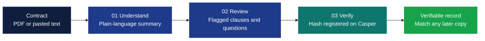

---

## System Architecture

LexProof AI consists of a React frontend, a FastAPI backend, the Gemini AI engine, a database for saved analyses, and the Casper Testnet for verification.

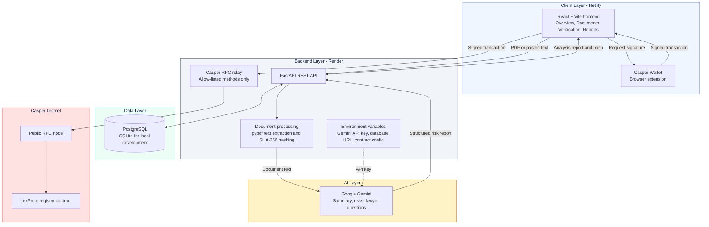

### Components

| Component | Responsibility |
|---|---|
| **Frontend (Netlify)** | Document upload, text input, results display, history, wallet connection, PDF report generation |
| **Backend API (Render)** | Orchestrates analysis, hashing, Gemini calls, database access, and Casper endpoints |
| **Document processing** | Extracts text from PDFs with `pypdf` and computes the SHA-256 hash |
| **Google Gemini** | Generates the summary, obligations, risk findings, and lawyer questions |
| **Database** | Persists analysis history and blockchain status (PostgreSQL in production, SQLite locally) |
| **Casper RPC relay** | Forwards signed transactions and read-only queries to the node |
| **Casper Wallet** | Lets the user sign verification transactions |
| **Registry contract** | Stores registered document hashes on-chain |

**Why a relay?** Casper nodes do not accept requests directly from browser pages (CORS). The backend therefore forwards signed transactions and read-only queries to the node. It only forwards a fixed allow-list of RPC methods.

---

## Workflow Diagrams

### Document Analysis Flow

What happens when a user clicks **Analyze document**.

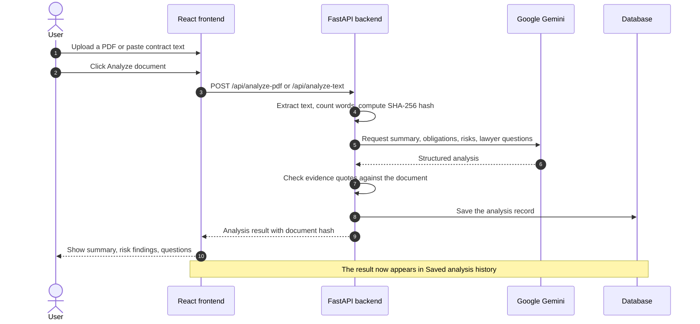

### Blockchain Registration Flow

The full journey from analysis result to an on-chain record.

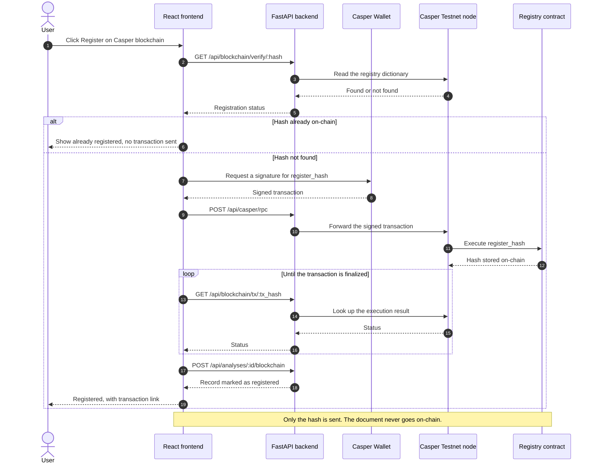

### Verification Logic

How registration and later integrity checks decide their outcome.

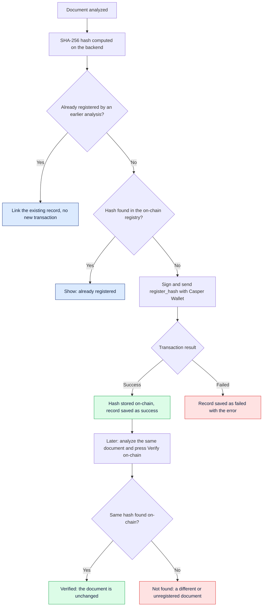

The hash is calculated from the exact content that is analyzed: the bytes of an uploaded PDF, or the pasted text. Changing even one character produces a completely different hash, which is what makes tamper detection reliable.

### Privacy by Design

What stays off-chain and what goes on-chain.

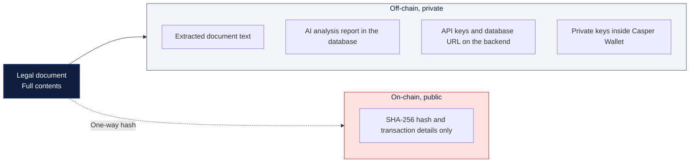

### User Journey

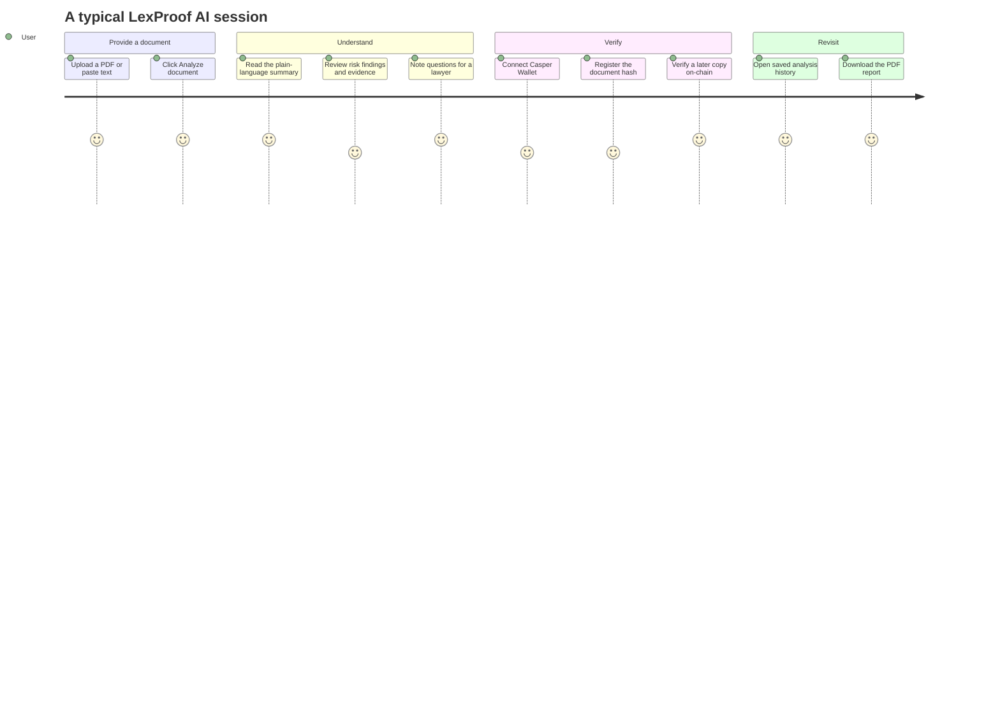

---

## Smart Contract

The registry contract is written in Rust for the Casper 2.0 network and lives in `contracts/lexproof-registry`.

**Entry point:** `register_hash(document_hash: String)`

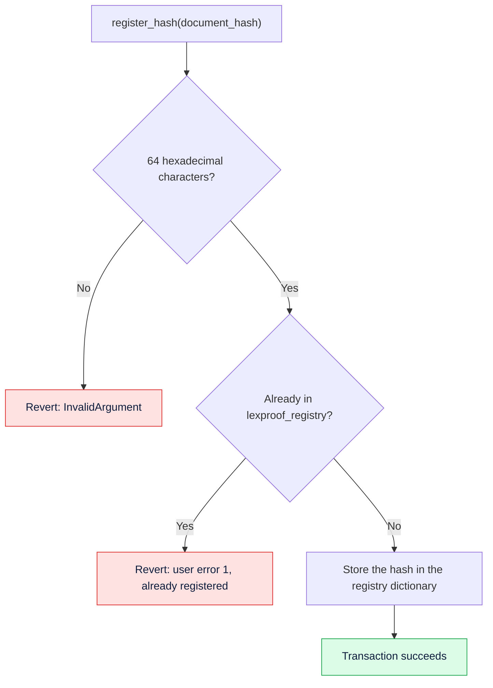

Verification does not need a transaction. The backend reads the `lexproof_registry` dictionary directly from the node, which is free.

### Current Testnet deployment (`casper-test`)

| Item | Value |
|---|---|
| **Contract hash** | `2568a51ef91d7ed544d11f86de29fa45b431e032c06c6454ae0462a79253201f` |
| **Package hash** | `dafbd48e899b876747a46c780298799f6bd217df0263e42d240d1610c96468fc` |
| **Registry URef** | `uref-7182191a1edad9c3a5a9e1b3856b1c38095090d99d06614a80e99532cc1a0bf2-007` |
| **Install transaction** | `1af83dc21c1289ef56f9e241b3a3b68b88c614adba1053ac7e986b5c88261898` |

You can inspect these on the [Casper Testnet explorer](https://testnet.cspr.live). These values are public on-chain data, not secrets.

---

## Data Model

Each analysis is saved as one row in the `analysis_records` table. The blockchain columns stay empty until a document is registered.

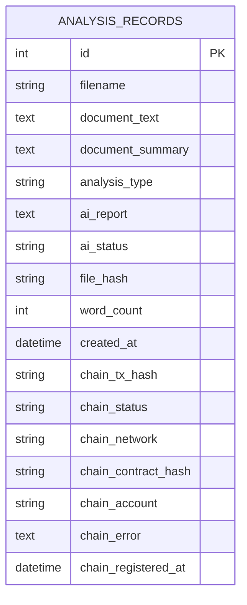

The blockchain status of a record moves through these states:

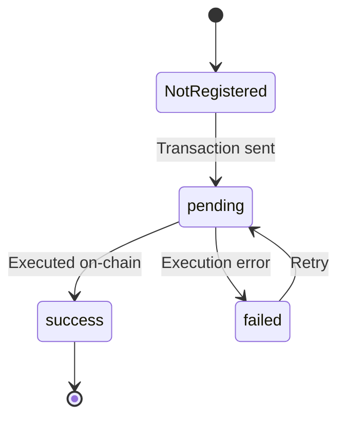

The backend creates missing columns automatically on startup, so existing databases upgrade without manual migration.

---

## Tech Stack

| Layer | Technology |
|---|---|
| **Frontend** | React 19, Vite 8, Axios, jsPDF, casper-js-sdk 5 |
| **Backend** | Python, FastAPI, Uvicorn, SQLAlchemy 2, pypdf |
| **AI** | Google Gemini through the `google-genai` SDK |
| **Database** | PostgreSQL in production, SQLite for local development |
| **Blockchain** | Casper Testnet, Casper Wallet |
| **Smart contract** | Rust with `casper-contract` 5.1.1 and `casper-types` 6.1.0 |
| **Hosting** | Netlify (frontend), Render (backend) |

---

## Project Structure

```text
LexProof-AI/
├── assets/
│   └── logo.svg                 Project logo
├── backend/
│   ├── main.py                  FastAPI app, database, Casper endpoints
│   ├── ai_analysis.py           Gemini prompt, response parsing, evidence checks
│   └── requirements.txt
├── frontend/
│   ├── src/
│   │   ├── App.jsx              Main interface
│   │   ├── casperWallet.js      Casper Wallet connection
│   │   ├── casperRegistry.js    Register, verify, and status helpers
│   │   ├── generateReport.js    PDF report generation
│   │   ├── DeployContract.jsx   One-time contract deployment page
│   │   └── main.jsx
│   ├── index.html
│   └── package.json
├── contracts/
│   └── lexproof-registry/
│       ├── src/lib.rs           The registry contract
│       ├── check_wasm.py        Checks a build is accepted by Casper
│       ├── rust-toolchain.toml
│       ├── Cargo.toml
│       └── Cargo.lock
└── package.json
```

---

## Getting Started

### Prerequisites

- **Python** 3.10 or newer
- **Node.js** 20 or newer, with npm
- A **Gemini API key** from [Google AI Studio](https://aistudio.google.com/)
- The **Casper Wallet** browser extension, with a Testnet account funded with test CSPR from the [Testnet faucet](https://testnet.cspr.live/tools/faucet)
- **Rust** is only needed if you want to rebuild the smart contract

### Backend Setup

```bash
cd backend
python -m venv .venv

# Windows PowerShell
.venv\Scripts\Activate.ps1
# macOS or Linux
source .venv/bin/activate

pip install -r requirements.txt
```

Create `backend/.env`:

```dotenv
GEMINI_API_KEY=your_gemini_api_key
CASPER_CONTRACT_HASH=2568a51ef91d7ed544d11f86de29fa45b431e032c06c6454ae0462a79253201f
CASPER_REGISTRY_UREF=uref-7182191a1edad9c3a5a9e1b3856b1c38095090d99d06614a80e99532cc1a0bf2-007
```

Start the server:

```bash
uvicorn main:app --reload --port 8000
```

Open http://127.0.0.1:8000/health. It should report `"status": "ok"`. Interactive API docs are at http://127.0.0.1:8000/docs.

### Frontend Setup

```bash
cd frontend
npm install
```

Create `frontend/.env`:

```dotenv
VITE_API_URL=http://127.0.0.1:8000
VITE_CASPER_TX_FORMAT=legacy
```

Start the development server:

```bash
npm run dev
```

Open http://localhost:5173.

### Environment Variables

> Never commit `.env` files. They are already listed in `.gitignore`. If a key is ever exposed, rotate it immediately.

**Backend**

| Variable | Required | Description |
|---|---|---|
| `GEMINI_API_KEY` | Yes | Key for the Gemini API. Without it only the keyword scan runs. **Secret.** |
| `GEMINI_MODEL` | No | Gemini model name. A default is built in. |
| `CASPER_CONTRACT_HASH` | Yes, for blockchain | 64-character contract hash, without any `hash-` prefix. |
| `CASPER_REGISTRY_UREF` | Recommended | Registry dictionary URef, used for reliable on-chain verification. |
| `CASPER_NETWORK` | No | Chain name. Defaults to `casper-test`. |
| `CASPER_NODE_RPC` | No | Node RPC address. Defaults to the public Testnet node. |
| `CASPER_EXPLORER_TX_URL` | No | Explorer link prefix for transactions. |
| `DATABASE_URL` | No | Database connection string. Defaults to a local SQLite file. **Secret** in production. |
| `FRONTEND_ORIGINS` | No | Extra allowed frontend addresses, separated by commas. |

**Frontend**

| Variable | Required | Description |
|---|---|---|
| `VITE_API_URL` | Yes | Address of the backend, with no slash at the end. |
| `VITE_CASPER_TX_FORMAT` | No | `legacy` (recommended) or `v2`. |
| `VITE_CASPER_PAYMENT_CSPR` | No | Payment limit per registration, in CSPR. Defaults to `10`. |

Vite reads `.env` only when it starts, so restart `npm run dev` after changing it.

---

## Using the App

1. Open the [live app](https://lexproof-ai.netlify.app/) and **upload a PDF** (up to 15 MB) or **paste contract text**, then press **Analyze document**.
2. Read the AI report: summary, key obligations, risk findings with evidence, and questions for a lawyer.
3. Press **Register on Casper blockchain**. Casper Wallet asks you to connect and then to sign. Keep the wallet on Testnet.
4. Wait about a minute. The page reports when the hash is registered, and the record is saved with its transaction link.
5. Press **Verify on-chain** at any time to check the hash against the blockchain.
6. Download the **PDF report**. It includes the blockchain verification details.

### Workspace navigation

| Section | Purpose |
|---|---|
| **Overview** | Dashboard with session stats, document analysis, and saved history |
| **Documents** | Manage documents you have analyzed |
| **Blockchain Verification** | Lists every registered document with a link to its transaction |
| **Reports** | Access generated analysis reports |

### Dashboard metrics

| Metric | Meaning |
|---|---|
| **Documents selected** | Documents chosen in the current session |
| **Saved analyses** | Analyses retrieved from the database |
| **Verified records** | Documents registered on the Casper blockchain |

### Saved analysis history

Every analysis is saved and listed with its document name (or *Pasted text*), report type (**AI report ready** or **Keyword scan**), date and time, word count, number of topics flagged, and a **View saved result** action. Use **Refresh history** to pull the latest results from the backend.

---

## API Reference

Interactive documentation is available at `/docs` on the running backend.

| Method | Endpoint | Description |
|---|---|---|
| `GET` | `/` | Service information |
| `GET` | `/health` | Database and configuration health check |
| `POST` | `/api/analyze-text` | Analyze pasted text (`text`, `filename`) |
| `POST` | `/api/analyze-pdf` | Analyze an uploaded PDF (multipart `file`) |
| `GET` | `/api/analyses` | List saved analyses |
| `GET` | `/api/analyses/{id}` | Get one saved analysis |
| `POST` | `/api/analyses/{id}/blockchain` | Save the blockchain result for an analysis |
| `GET` | `/api/blockchain/config` | Network and contract settings used by the frontend |
| `GET` | `/api/blockchain/verify/{document_hash}` | Check whether a hash is registered on-chain |
| `GET` | `/api/blockchain/tx/{tx_hash}` | Status of a registration transaction |
| `POST` | `/api/casper/rpc` | Relay for signed transactions and read-only queries |

---

## Building and Deploying the Contract

You only need this to rebuild the contract or deploy your own copy. **A rejected deployment still costs the full payment**, so check the build before you deploy.

**1. Build as plain WebAssembly.** The Casper node rejects the newer WebAssembly instructions that recent Rust versions emit by default, so the contract is built with the `mvp` CPU target. In PowerShell:

```powershell
cd contracts\lexproof-registry
cargo clean
$env:RUSTFLAGS = "-C target-cpu=mvp -C target-feature=+mutable-globals"
cargo build --release --target wasm32-unknown-unknown "-Zbuild-std=core,alloc,panic_abort" "-Zbuild-std-features=compiler-builtins-mem"
```

The Rust toolchain is pinned in `rust-toolchain.toml`.

**2. Check the result.**

```powershell
python check_wasm.py path\to\lexproof_registry.wasm
```

Deploy only if the last line says `RESULT: OK`.

**3. Deploy once.** Start the frontend and open `/?deploy`. Choose the `.wasm` file and approve the transaction in Casper Wallet. Installing a second time fails, because the registry dictionary already exists.

**4. Find the contract hash.** On the Testnet explorer, open your account, then **On-chain data**, then the named keys. Copy `lexproof_contract_hash`, remove any `hash-` prefix, and set it as `CASPER_CONTRACT_HASH`. Copy the `lexproof_registry` value and set it as `CASPER_REGISTRY_UREF`.

---

## Hosting on Render and Netlify

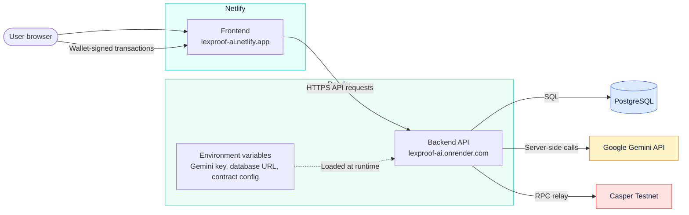

**Backend on Render (web service)**

| Setting | Value |
|---|---|
| Root directory | `backend` |
| Build command | `pip install -r requirements.txt` |
| Start command | `uvicorn main:app --host 0.0.0.0 --port $PORT` |

In the Render dashboard, open **Environment** and set `GEMINI_API_KEY`, `CASPER_CONTRACT_HASH`, `CASPER_REGISTRY_UREF`, and `DATABASE_URL`. Use a **PostgreSQL** database for `DATABASE_URL`, because on Render's free plan a local SQLite file is erased whenever the service restarts. Add `FRONTEND_ORIGINS` if your frontend address is not already allowed.

**Frontend on Netlify**

| Setting | Value |
|---|---|
| Base directory | `frontend` |
| Build command | `npm run build` |
| Publish directory | `frontend/dist` |

Set `VITE_API_URL` to your Render address and `VITE_CASPER_TX_FORMAT` to `legacy`. Netlify applies these at build time, so trigger a new deploy after changing them.

---

## Privacy and Security

- **On-chain data:** only the SHA-256 hash and the transaction details are written to the blockchain. The document is never put on-chain.
- **One-way hashes:** a hash proves a document's integrity but cannot be reversed to reveal its contents.
- **Backend storage:** the backend saves the extracted document text and the AI report in its database so that history works. Do not upload sensitive or confidential documents to the public demo.
- **Third-party processing:** document text is sent to Google Gemini for analysis.
- **Keys:** private keys never touch this application. Casper Wallet signs transactions inside the extension.
- **Secrets:** the Gemini API key and database URL live in environment variables and `.env` files, which are excluded from git and never exposed to the browser.
- **Transport:** the frontend and backend are both served over HTTPS.
- **RPC relay:** it only forwards a fixed list of Casper RPC methods. The API has no user authentication yet, so treat the deployment as a demo.

---

## Limitations

- Runs on the **Casper Testnet** only. Registered hashes have no real-world value or permanence guarantees, and a testnet can be reset.
- A hash proves a document is unchanged since registration. It does not prove who wrote it, who registered it, or that it is legally valid or enforceable.
- Anyone can register any hash, and the contract does not yet record an owner or a timestamp.
- Scanned or image-only PDFs are not supported, because there is no OCR.
- Each registration sends a transaction with a payment limit of 10 CSPR. Testnet CSPR is free, but a rejected transaction still costs the payment.
- AI findings can be incomplete or wrong.

---

## Prototype Snapshot

State of the development environment at the time of writing (October 2026):

| Metric | Value |
|---|---|
| Saved analyses | 16 |
| Records registered on Casper | 2 |

Documents used in demos include `Aegis_Monetary_Network_Concept_Paper_v0.1.pdf` and `goldguard-silver-certificate.pdf`.

---

## Roadmap

- [x] PDF upload and pasted-text analysis
- [x] Gemini-powered reports with evidence checking
- [x] Saved analysis history
- [x] Casper Wallet connection and wallet-signed registration
- [x] Duplicate protection and on-chain verification
- [x] Downloadable PDF reports with blockchain verification details
- [x] Production deployment on Netlify and Render
- [ ] Verify a document by uploading it, with the hash computed in the browser
- [ ] Side-by-side clause comparison between document versions
- [ ] Contract upgrade with owner, timestamp, and revocation
- [ ] An option to avoid storing document text
- [ ] User accounts and access control for saved analyses
- [ ] Multi-language contract support
- [ ] Automated tests and continuous integration
- [ ] Casper Mainnet support
- [ ] Full interface polish and branding refresh

---

## Disclaimer

**LexProof AI is a prototype and does not provide legal advice.**

AI-generated summaries and flagged clauses are informational only and may be incomplete or inaccurate. Always review the original document and consult a qualified lawyer before making legal decisions or signing any agreement.

---

## Contributing

Contributions, ideas, and feedback are welcome.

1. Fork the repository
2. Create a feature branch: `git checkout -b feature/your-feature`
3. Commit your changes: `git commit -m "Add your feature"`
4. Push to the branch: `git push origin feature/your-feature`
5. Open a Pull Request

> Never commit `.env` files or API keys when contributing.

---

## License

This project is released under the **MIT License**.

---

## Author

Built by **Hajrajadoon**.

---

<div align="center">

**[Live App](https://lexproof-ai.netlify.app/)** · **[Backend API](https://lexproof-ai.onrender.com)**

**LexProof AI** · Legal intelligence, with transparency.

*Prototype · Not legal advice*

</div>
