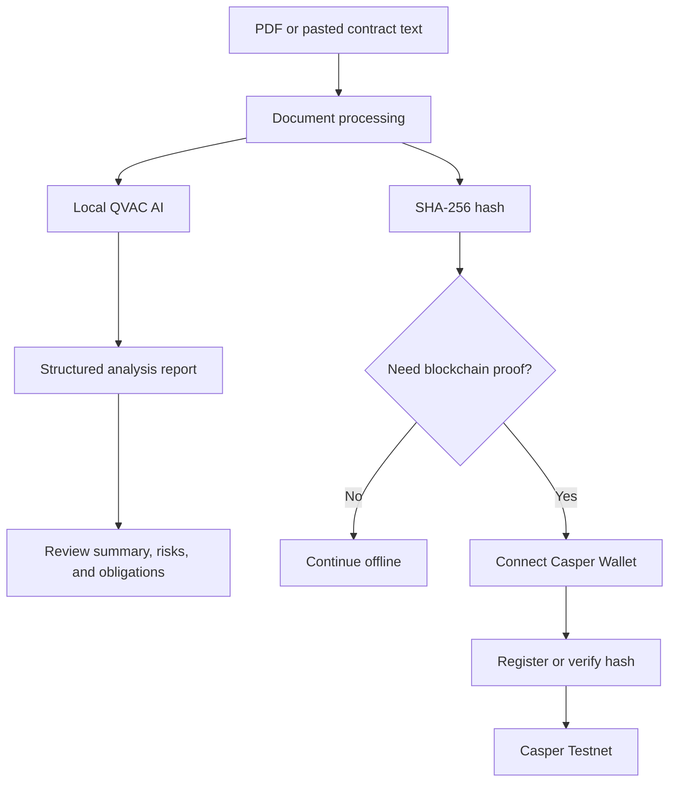
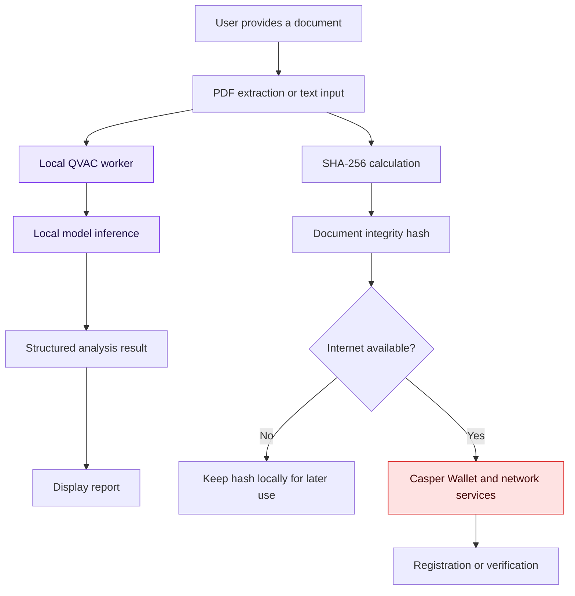
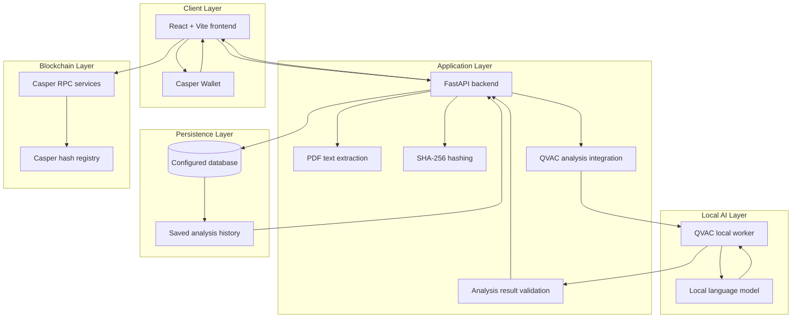
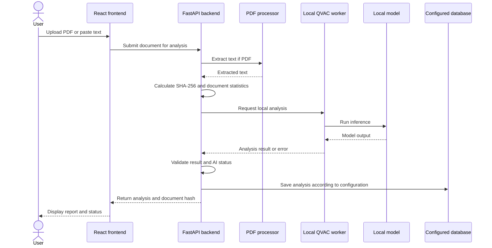
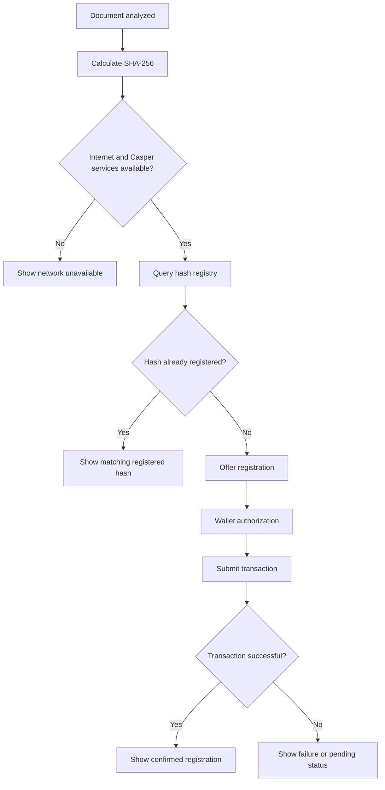
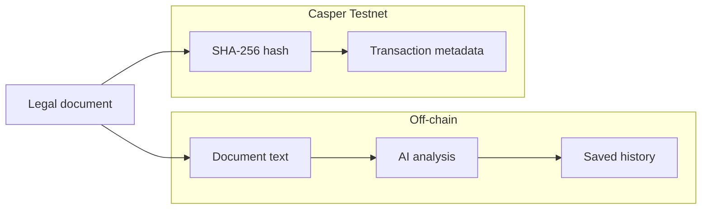

# LexProof Pocket

<div align="center">


<br />

### Clarity for every contract.

**Privacy-focused legal document intelligence powered by local QVAC AI, with blockchain-backed document integrity verification.**

<br />


<br />

**Local AI · Legal document intelligence · SHA-256 · Casper blockchain**

</div>

---

## Table of Contents

- [Overview](#overview)
- [The Problem and Our Solution](#the-problem-and-our-solution)
- [Key Features](#key-features)
- [How LexProof Pocket Works](#how-lexproof-pocket-works)
- [Offline-First AI Architecture](#offline-first-ai-architecture)
- [System Architecture](#system-architecture)
- [Document Analysis Workflow](#document-analysis-workflow)
- [Blockchain Registration and Verification](#blockchain-registration-and-verification)
- [Privacy by Design](#privacy-by-design)
- [Tech Stack](#tech-stack)
- [Project Structure](#project-structure)
- [Getting Started](#getting-started)
- [Using the App](#using-the-app)
- [Workspace](#workspace)
- [API Reference](#api-reference)
- [Security and Data Handling](#security-and-data-handling)
- [Limitations](#limitations)
- [Roadmap](#roadmap)
- [Disclaimer](#disclaimer)
- [Contributing](#contributing)
- [License](#license)
- [Author](#author)

---

## Overview

Legal documents are often long, complex, and difficult to interpret. Important obligations, deadlines, and potentially risky clauses can be easy to overlook.

**LexProof Pocket** is a legal document intelligence prototype designed to help users understand documents, identify clauses that deserve closer review, and verify document integrity using blockchain technology.

The application combines local AI analysis with cryptographic hashing and Casper Testnet integration.

### The three-step workflow

1. **Understand** — Analyze a PDF or pasted contract text and generate a plain-language report.
2. **Review** — Examine potential risks, key obligations, supporting evidence, and questions to discuss with a qualified lawyer.
3. **Verify** — Register a document's SHA-256 hash on the Casper blockchain and check whether a document matches a previously registered hash.

### Local AI processing

LexProof Pocket integrates **QVAC local AI** to analyze document text on the user's computer. Once the required model and local runtime are available, AI inference can run without sending document text to a cloud-based AI service.

This is particularly useful for users who want to analyze documents when internet connectivity is unavailable.

Blockchain operations are separate from local AI analysis. Connecting a Casper Wallet, submitting transactions, and querying the network require internet connectivity.

### Privacy by design

**Only the SHA-256 document hash is registered on the blockchain. The document itself is never intentionally written on-chain.**

However, local AI processing does not automatically mean that all application data remains exclusively on the user's device. Saved analysis history depends on the application's configured database, and users should understand where document text and reports are stored before uploading sensitive information.

LexProof Pocket is a prototype, not a substitute for professional legal advice.

---

## The Problem and Our Solution

### The problem

- Legal agreements often contain complicated language that is difficult to understand.
- Important obligations, payment conditions, deadlines, and risks can be overlooked.
- Users may struggle to identify which clauses require further professional review.
- Documents can be modified after being signed, shared, or archived.
- Cloud-based AI analysis may be unsuitable for users who need offline processing or want to limit third-party access to document text.
- Publishing complete legal documents on a public blockchain would expose confidential information.

### Our solution

LexProof Pocket separates document understanding from blockchain verification.

| Need | LexProof Pocket approach |
|---|---|
| Understand a document | Local QVAC AI generates a structured analysis report |
| Identify potential concerns | Review flagged risks and supporting evidence |
| Understand responsibilities | Extract key obligations and relevant statements |
| Prepare for legal consultation | Generate questions to discuss with a lawyer |
| Analyze without an AI cloud request | Use the local QVAC runtime when available |
| Revisit earlier work | Browse saved analyses retrieved from the configured backend |
| Check document integrity | Calculate a SHA-256 hash and compare it with the Casper registry |
| Protect document contents on-chain | Register the hash rather than the full document |

---

## Key Features

### Document analysis

- **PDF upload:** Upload PDF documents up to 15 MB.
- **Pasted-text analysis:** Paste contract text, with an interface limit of up to 100,000 characters.
- **Local QVAC AI:** Run supported AI inference through a local model runtime.
- **Plain-language summaries:** Understand the main subject and meaning of a document.
- **Key obligations:** Identify responsibilities, deadlines, and other potentially relevant statements.
- **Risk review:** Display potential concerns that may deserve closer examination.
- **Evidence and lawyer questions:** Present supporting text and questions for professional review.
- **AI status reporting:** Distinguish completed AI analysis from unavailable or unsuccessful AI processing.

AI output depends on the quality of the extracted text, the model's capabilities, and successful execution of the local runtime.

### Saved analysis history

- Retrieve previously saved analysis records from the configured backend.
- View the document name or pasted-text label.
- See the date, time, and word count.
- Reopen saved reports.
- Refresh the analysis history.
- Review whether an analysis was completed by AI or reported as unavailable.

The database may store extracted document text and generated reports. Local inference and database storage are separate concerns.

### Blockchain integrity verification

- Generate a SHA-256 hash for a document.
- Connect a Casper Wallet.
- Request a wallet signature for blockchain registration.
- Register the hash on Casper Testnet.
- Check whether a hash exists in the on-chain registry.
- Display registration and verification status.

The document hash is used to detect changes to the exact content that was hashed. A matching hash does not prove the identity of the author or the legal validity of the document.

### Workspace dashboard

The workspace provides navigation for:

- **Overview** — Main dashboard, analysis controls, and recent results.
- **Documents** — Document-related workspace functionality.
- **Blockchain Verification** — Blockchain verification interface.
- **Reports** — Report-related workspace functionality.

The availability of individual actions depends on the current application configuration and successful communication with the relevant services.

---

## How LexProof Pocket Works

| Step | Stage | Description |
|:---:|---|---|
| 01 | **Understand** | Provide a PDF or paste document text for local AI analysis. |
| 02 | **Review** | Examine the summary, potential risks, obligations, evidence, and lawyer questions. |
| 03 | **Verify** | Calculate the document hash and optionally register or verify it on Casper Testnet. |



Document analysis can operate independently of blockchain transactions. Blockchain registration and network verification require the relevant network services to be reachable.

---

## Offline-First AI Architecture

LexProof Pocket is designed to support local document analysis through QVAC.



### What works offline?

When the local model and required runtime are installed and available, document analysis can run without an internet connection to an AI provider.

Offline operation may include:

- Pasting text.
- Processing supported PDFs.
- Running local inference.
- Generating analysis results.
- Calculating SHA-256 hashes.

The precise availability of saving, history, and other features depends on whether their backing services are local or remote.

### What requires internet access?

- Connecting to Casper network services.
- Submitting blockchain transactions.
- Checking transaction status.
- Querying the on-chain registry.
- Any operation that depends on a remotely hosted API or database.

**Important:** If the QVAC worker fails, LexProof Pocket should not represent a keyword-only result as a successful AI report. AI availability and the analysis method should be communicated accurately.

---

## System Architecture

LexProof Pocket combines a React frontend, a FastAPI backend, a local QVAC inference worker, document processing, a configured database, and Casper blockchain services.



### Component responsibilities

| Component | Responsibility |
|---|---|
| **React + Vite frontend** | Document input, workspace navigation, reports, saved history, and blockchain controls |
| **FastAPI backend** | Coordinates document processing, analysis integration, persistence, and supported API operations |
| **PDF processing** | Extracts readable text from supported PDF documents |
| **SHA-256** | Produces a cryptographic fingerprint of the analyzed content |
| **QVAC integration** | Invokes the local inference workflow |
| **QVAC worker** | Communicates with the local model runtime and returns analysis output |
| **Result validation** | Checks the returned analysis before it is presented as a completed AI report |
| **Database** | Persists analysis history according to the configured database connection |
| **Casper Wallet** | Lets users authorize blockchain transactions |
| **Casper network services** | Handle transactions and on-chain registry queries |

The exact deployment arrangement may vary between local development and hosted environments. Local AI inference, application hosting, database persistence, and blockchain connectivity should be treated as separate services.

---

## Document Analysis Workflow



The worker may fail for reasons such as model initialization errors, insufficient available memory, runtime failures, malformed output, or response-validation errors.

A successful PDF upload or saved analysis record does not, by itself, prove that AI inference succeeded. The application should distinguish document processing, AI completion, and persistence status.

---

## Blockchain Registration and Verification

LexProof Pocket uses a document's SHA-256 hash to support integrity checks through Casper Testnet.

### Registration

1. Analyze the document and calculate its hash.
2. Connect the Casper Wallet.
3. Request the user's authorization for registration.
4. Submit the wallet-authorized transaction through the configured network integration.
5. Check the transaction result.
6. Display the registration status after successful confirmation.

### Verification

1. Calculate the hash of the document being checked.
2. Query the Casper registry.
3. Compare the calculated hash with the registered value.
4. Report whether the hash was found.



### What a hash proves

A matching SHA-256 hash provides evidence that the checked content matches the content represented by the registered hash, assuming the hash and comparison process are implemented correctly.

It does **not** independently prove:

- Who created or signed the document.
- Whether a signature is authentic.
- Whether a document is legally valid or enforceable.
- Whether the document was fair or free from fraud.
- Whether the original document was truthful.

Only the document hash is intended to be registered on-chain. Blockchain transactions and their associated public metadata may remain publicly visible.

---

## Privacy by Design

LexProof Pocket is built around a separation between local document analysis and public blockchain integrity records.



### Data handling principles

- **Local inference:** QVAC can analyze text using the local model runtime without sending the inference request to a cloud AI provider.
- **No document on-chain:** The full document is not intentionally stored on the blockchain by the hash-registration workflow.
- **Hash-based verification:** The SHA-256 hash is used for integrity checking.
- **Wallet-controlled signing:** Transaction authorization is handled through Casper Wallet.
- **Database awareness:** Saved analyses may include extracted text and reports, depending on the application's persistence implementation.
- **Network awareness:** Blockchain operations require internet connectivity and accessible Casper services.

### A note on confidentiality

A SHA-256 hash is not encryption. Although it does not directly contain the document text, hashes of predictable documents may sometimes be matched against known content.

Local inference also does not automatically make the complete application private. Users should confirm whether the configured database, logs, temporary files, and backups are stored locally or remotely.

Do not upload sensitive or confidential documents to a public demo unless you understand the applicable data-storage and processing arrangements.

---

## Tech Stack

| Layer | Technology |
|---|---|
| **Frontend** | React, Vite, JavaScript |
| **Backend** | Python, FastAPI, Uvicorn |
| **Document processing** | `pypdf` |
| **AI inference** | QVAC local AI integration |
| **Model runtime** | Local model/runtime configured for QVAC |
| **Integrity verification** | SHA-256 |
| **Database** | Configured application database; SQLite may be used for local development |
| **Blockchain** | Casper Testnet |
| **Wallet integration** | Casper Wallet |
| **Smart contract** | Casper registry contract, where deployed and configured |
| **Version control** | Git and GitHub |

Specific package versions and model requirements depend on the current project configuration.

---

## Project Structure

The following is a conceptual overview of the primary application components. The exact files and directories may differ from this illustration.

```text
LexProof-Pocket/
├── backend/
│   ├── main.py
│   ├── qvac_analysis.py
│   ├── qvac_local_worker.py
│   ├── requirements.txt
│   └── ...
├── frontend/
│   ├── src/
│   │   ├── App.jsx
│   │   └── ...
│   ├── package.json
│   └── ...
├── assets/
│   └── logo.svg
├── contracts/
│   └── ...
├── README.md
└── ...
```

- `backend/main.py` — Main FastAPI application and document-analysis endpoints.
- `backend/qvac_analysis.py` — QVAC analysis integration.
- `backend/qvac_local_worker.py` — Local model worker interface.
- `frontend/src/App.jsx` — Main workspace interface.
- `assets/logo.svg` — Existing project logo.

The QVAC runtime and model may require separate installation or configuration. Keep downloaded models, virtual environments, temporary diagnostics, credentials, and private configuration out of version control unless there is a deliberate and safe reason to include them.

---

## Getting Started

### Prerequisites

Before running LexProof Pocket locally, prepare:

- Python compatible with the backend dependencies.
- Node.js and npm compatible with the frontend.
- Git.
- The QVAC runtime and required local model.
- A Casper Wallet browser extension if you want to test blockchain operations.
- Internet access for initial setup, package installation, and Casper network operations.

**Important:** Installing the Python dependencies alone may not install the local model or make QVAC inference available. Follow the setup instructions for the QVAC runtime and model configured in your environment.

### 1. Clone the repository

```powershell
git clone https://github.com/Hajrajadoon/LexProof-Pocket.git
cd LexProof-Pocket
```

### 2. Set up the backend

```powershell
cd backend

python -m venv .venv

.\.venv\Scripts\Activate.ps1

pip install -r requirements.txt
```

If PowerShell blocks virtual-environment activation, consult the Python environment setup instructions for your Windows configuration.

### 3. Configure the local AI runtime

Make sure the configured QVAC runtime and model are installed and accessible to the application.

The exact model location, runtime settings, and launch configuration must match the current QVAC integration in the project.

Before testing through the application, verify that:

- The worker can locate the runtime.
- The model files are accessible.
- The computer has sufficient available memory.
- The worker can complete inference.
- The output can be parsed into a valid analysis result.

Do not assume the AI is working solely because the backend starts successfully.

### 4. Configure application settings

Review the current backend and frontend configuration before adding environment variables.

Do not copy configuration names from another LexProof project unless they exist in LexProof Pocket's code.

Keep secrets and private settings in local environment files that are excluded from Git. Do not commit wallet private keys, API tokens, credentials, or confidential documents.

### 5. Start the backend

From the backend directory, use the project's configured startup command. For a standard FastAPI application exposing `main:app`, the command is:

```powershell
uvicorn main:app --reload --port 8000
```

This command assumes that the backend dependencies are installed and that the application is configured to run in the current Python environment.

### 6. Start the frontend

Open another PowerShell window:

```powershell
cd C:\Users\user\LexProof-Pocket\frontend

npm install
npm run dev
```

Open the local address displayed by Vite in your terminal.

The frontend must point to the correct backend address for analysis and history operations to work.

### 7. Test local inference

Use a short, non-confidential sample document.

Confirm that:

1. The backend accepts the text or PDF.
2. QVAC is actually invoked.
3. The worker returns a valid result.
4. The interface reports successful AI completion.
5. The saved record can be reopened if persistence is configured.

Test offline behavior separately by disconnecting internet access after confirming that the local runtime and required resources are available.

### 8. Test Casper separately

Reconnect to the internet and confirm that:

1. Casper Wallet can connect.
2. The configured Casper Testnet services are reachable.
3. A transaction can be authorized and submitted.
4. The transaction status can be retrieved.
5. Verification correctly reports whether the hash is registered.

A local analysis test and a blockchain transaction test validate different parts of the application.

---

## Using the App

### Analyze a PDF

1. Open the workspace.
2. Find the **Upload a PDF** section.
3. Select a supported PDF document up to 15 MB.
4. Click **Analyze document**.
5. Wait for document extraction and the local AI workflow.
6. Review the resulting report and its AI status.

Image-only or scanned PDFs may not produce usable text without OCR support.

### Analyze pasted text

1. Open **Paste contract text**.
2. Enter the contract or document text.
3. Click **Analyze document**.
4. Review the generated summary, potential concerns, obligations, evidence, and lawyer questions.
5. Check that the report indicates whether QVAC completed successfully.

### Register a document hash

1. Analyze the document.
2. Locate the blockchain proof section.
3. Connect Casper Wallet.
4. Select the registration action.
5. Review and authorize the wallet request.
6. Wait for the transaction status.
7. Confirm that the interface reports registration only after the appropriate success condition is met.

### Verify a document

1. Analyze the document whose integrity you want to check.
2. Locate its SHA-256 hash.
3. Use **Verify on-chain**.
4. Wait for the network query.
5. Review whether the hash is found in the registry.

An offline document can be analyzed locally, but the application cannot obtain a new authoritative on-chain verification result while disconnected from the network.

---

## Workspace

LexProof Pocket provides a workspace with the following navigation.

| Section | Purpose |
|---|---|
| **Overview** | Main dashboard, document analysis, and recent saved results |
| **Documents** | Document-related workspace functionality |
| **Blockchain Verification** | Interface for checking document hashes and registration status |
| **Reports** | Report-related workspace functionality |

### Dashboard metrics

The dashboard can display:

- **Selected document** — The currently selected document, if any.
- **Saved analyses** — The number of saved analysis records returned by the backend.
- **Verified on-chain** — The number of records that the application counts as verified or registered.

These metrics depend on the application's data and status logic. A displayed count should not be interpreted as proof of an on-chain transaction unless the corresponding status has been confirmed.

### Saved analysis history

Saved results can display the document name, timestamp, word count, AI status, and a view action.

If an analysis reports that AI is unavailable, that record should not be treated as equivalent to a successful QVAC report.

---

## API Reference

LexProof Pocket uses a FastAPI backend.

The authoritative API surface is the current backend implementation. To inspect the available endpoints, run the backend and consult its generated API documentation if enabled.

For a typical local FastAPI setup, the documentation is often available at:

```text
http://127.0.0.1:8000/docs
```

The following are conceptual API responsibilities rather than a guarantee of exact route names:

| Responsibility | Description |
|---|---|
| **Document analysis** | Accept pasted text and supported document uploads |
| **Local AI integration** | Invoke QVAC and handle its response |
| **Analysis history** | Retrieve saved analysis records |
| **Analysis detail** | Retrieve an individual saved result |
| **Blockchain configuration** | Expose relevant network and registry configuration |
| **Hash verification** | Query the registry for a document hash |
| **Transaction status** | Retrieve a blockchain transaction result |
| **Health checks** | Report backend availability and configured dependencies |

Consult the current application code or generated API documentation before relying on a specific endpoint, request schema, or response format.

---

## Security and Data Handling

### Documents

Document contents may be processed locally by QVAC, but document text and reports may also be persisted by the backend.

Understand where data is stored, who can access the configured database, and whether logs or temporary files retain document content.

### AI output

AI-generated legal analysis can be incomplete, misleading, or incorrect. The application should distinguish successful local inference from errors and any fallback analysis.

Evidence quotes should be checked against the source text whenever possible. A plausible-sounding answer is not proof that the model correctly interpreted a legal document.

### Blockchain

- The registration workflow is intended to publish the document hash, not the full document.
- Blockchain records and transaction metadata may be publicly visible.
- A wallet signature authorizes a transaction; it does not establish legal validity.
- Testnet transactions are not equivalent to production legal or financial records.

### Credentials

- Never commit passwords, private keys, access tokens, or confidential environment files.
- Never put wallet private keys in frontend source code or public repositories.
- Use wallet-controlled signing for transactions.
- Review the configured backend, database, and RPC relay before exposing them publicly.

### Dependencies and backups

Keep local model files, Python virtual environments, build artifacts, temporary diagnostic logs, and recovery backups out of version control unless they are deliberately needed and safe to publish.

---

## Limitations

- **Prototype status:** LexProof Pocket is an experimental legal document intelligence application.
- **AI reliability:** Summaries, obligations, risk findings, and lawyer questions may be incomplete or inaccurate.
- **Model availability:** Local inference depends on a working QVAC runtime, accessible model files, and sufficient system resources.
- **Offline constraints:** Blockchain registration and authoritative network verification require connectivity.
- **PDF extraction:** Scanned documents may need OCR, which is not assumed to be available.
- **Persistence:** Saved analysis history depends on the configured backend and database.
- **Blockchain scope:** The app is designed for Casper Testnet; testnet availability and records are not guaranteed to persist indefinitely.
- **Integrity scope:** A hash can support content-integrity checks but does not prove authorship, consent, legal validity, or enforceability.
- **Privacy scope:** Local inference does not automatically mean every application component stores all data exclusively on the user's device.
- **Legal review:** AI findings should never replace review by a qualified lawyer.

---

## Roadmap

The following items describe potential improvements and should not be interpreted as claims that every item is already implemented.

- [x] PDF upload interface
- [x] Pasted-text analysis interface
- [x] Local QVAC integration
- [x] Structured legal analysis report interface
- [x] SHA-256 document hashing
- [x] Saved analysis history interface
- [x] Casper Wallet integration interface
- [x] Casper registration and verification interface
- [ ] Improve QVAC runtime reliability and error reporting
- [ ] Add automated tests for analysis parsing and validation
- [ ] Improve legal obligation extraction and evidence accuracy
- [ ] Distinguish enforceable obligations from personal statements and general observations
- [ ] Add robust OCR support for scanned PDFs
- [ ] Make local versus remote storage behavior explicit
- [ ] Add optional local-only analysis history
- [ ] Improve offline-state indicators and network error handling
- [ ] Add stronger integration tests for Casper registration and verification
- [ ] Improve user access controls and document-retention options
- [ ] Add version comparison and document-change reports
- [ ] Evaluate additional language support

---

## Disclaimer

**LexProof Pocket is a prototype and does not provide legal advice.**

AI-generated summaries, obligations, risks, and questions are informational only and may be incomplete or incorrect. Always review the original document and consult a qualified lawyer before making legal decisions or signing an agreement.

Blockchain registration provides a hash-based integrity reference. It does not independently prove authorship, consent, authenticity, enforceability, or legal validity.

---

## Contributing

Contributions, ideas, bug reports, and feedback are welcome.

1. Fork the repository.
2. Create a feature branch:

   ```bash
   git checkout -b feature/your-feature
   ```

3. Make and test your changes.
4. Commit your changes:

   ```bash
   git commit -m "Describe your change"
   ```

5. Push your branch:

   ```bash
   git push origin feature/your-feature
   ```

6. Open a Pull Request.

Please do not commit `.env` files, credentials, private keys, confidential documents, local model weights, or unnecessary diagnostic and backup files.

---

## License

This project is released under the **MIT License**, provided the repository's existing license file confirms those terms.

---

## Author

Built by **Hajra Jadoon**.

---

<div align="center">

**LexProof Pocket**

*Legal intelligence, with transparency.*

**Local AI · Document integrity · Blockchain verification**

*Prototype · Not legal advice*

</div>
